# Examples

Every script opens the NetLogo window; with `NETLOGOPY_HEADLESS=1` it runs without it.
Run them from the repository root:

```bash
python Examples/advanced/38-python-policy.py
```

The [examples page](https://bouaziznourddine.github.io/netlogopy/examples/) of the documentation explains each one, with its results and its code.

## Applications

| | |
|---|---|
| 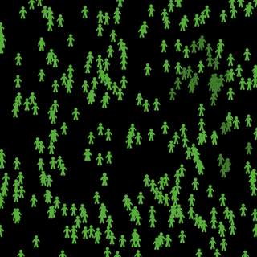 | **[A vaccination policy in an epidemic](advanced/38-python-policy.py)**<br>Python gives 6 vaccine doses every 5 ticks to the most exposed people: 50 people fall ill instead of 153.<br>[Details](https://bouaziznourddine.github.io/netlogopy/examples/#python-policy) |
| 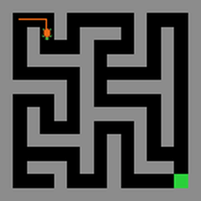 | **[Reinforcement learning in a maze](advanced/40-q-learning.py)**<br>NetLogo is the environment, a Python Q-table the learner; after 120 episodes the robot takes the shortest route.<br>[Details](https://bouaziznourddine.github.io/netlogopy/examples/#q-learning) |
| 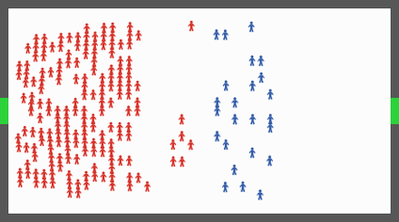 | **[Evacuating a room](advanced/43-evacuation.py)**<br>Python sends each person to the exit that gets them out soonest: 77 ticks instead of 92.<br>[Details](https://bouaziznourddine.github.io/netlogopy/examples/#evacuation) |
| 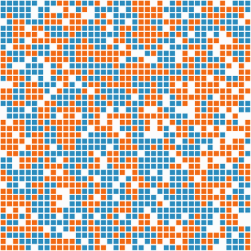 | **[Schelling segregation](advanced/42-segregation.py)**<br>Python measures the segregation and finds the largest blocks by flood fill.<br>[Details](https://bouaziznourddine.github.io/netlogopy/examples/#segregation) |
| 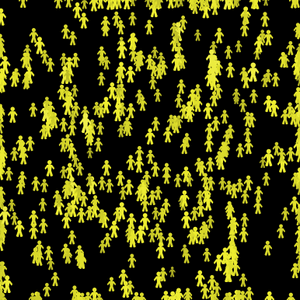 | **[Inequality and a wealth tax](advanced/44-wealth-tax.py)**<br>A Python controller sets the tax from the Gini coefficient: 0.28 instead of 0.42.<br>[Details](https://bouaziznourddine.github.io/netlogopy/examples/#wealth-tax) |
| 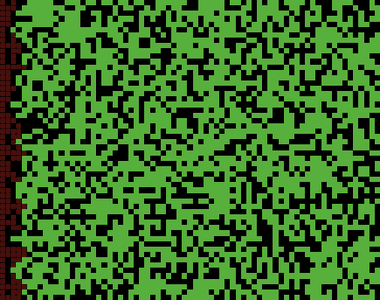 | **[Calibrating a model](advanced/39-calibrate-model.py)**<br>A bisection over 112 Fire runs in 4 parallel sessions finds the density that burns half the forest.<br>[Details](https://bouaziznourddine.github.io/netlogopy/examples/#calibrate) |
| 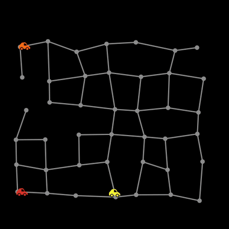 | **[Routing cars](advanced/41-shortest-routes.py)**<br>Dijkstra in Python on the NetLogo road network, rerouting when a road closes.<br>[Details](https://bouaziznourddine.github.io/netlogopy/examples/#routes) |
| 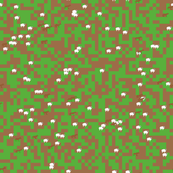 | **[Start, pause, change and stop](advanced/37-start-pause-stop.py)**<br>Wolf Sheep runs in the background; Python pauses it, changes the wolves and resumes it.<br>[Details](https://bouaziznourddine.github.io/netlogopy/examples/#start-pause-stop) |
| 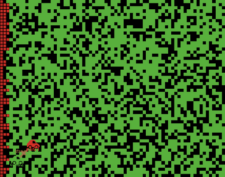 | **[Python agents in the Fire model](complexe/Fire/Fire.py)**<br>The NetLogo Models Library model, with two cars and a street driven by Python.<br>[Details](https://bouaziznourddine.github.io/netlogopy/examples/#existing-models) |
| 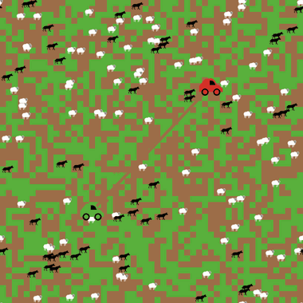 | **[Python agents in Wolf Sheep Predation](complexe/Wolf%20Sheep/Wolf.py)**<br>The same, in Wolf Sheep Predation.<br>[Details](https://bouaziznourddine.github.io/netlogopy/examples/#existing-models) |
| 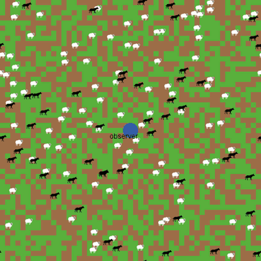 | **[Controlling an existing model](complexe/27-external-model.py)**<br>Open a model without its setup, set its widgets, add Python agents.<br>[Details](https://bouaziznourddine.github.io/netlogopy/examples/#existing-models) |
| 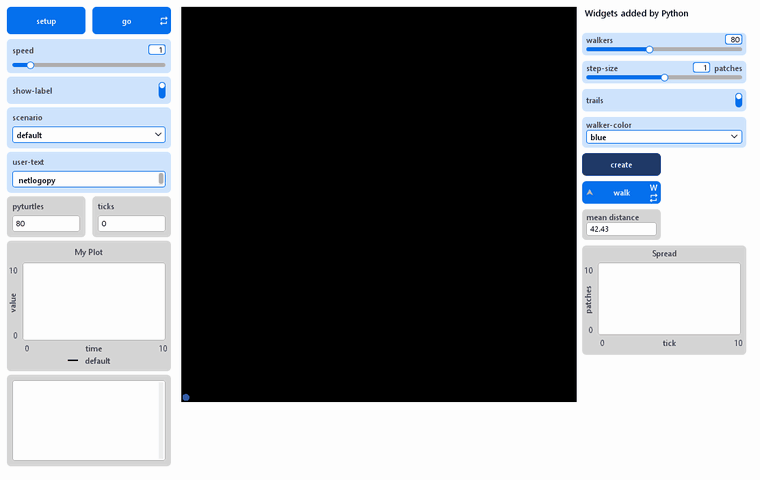 | **[Interface widgets added from Python](advanced/36-add-widgets.py)**<br>Sliders, switches, buttons, monitors and a plot added to the NetLogo window, then used by Python.<br>[Details](https://bouaziznourddine.github.io/netlogopy/examples/#widgets) |

## The `NetLogo` class

| | |
|---|---|
|  | **[Quick start](advanced/28-quickstart.py)**<br>Agents as Python objects, `command`, `report`, Python values.<br>[Details](https://bouaziznourddine.github.io/netlogopy/examples/#quickstart) |
| 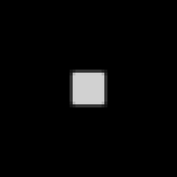 | **[Patches as a grid](advanced/29-patches-grid.py)**<br>A whole patch variable written and read in one call, `diffuse`.<br>[Details](https://bouaziznourddine.github.io/netlogopy/examples/#patches-grid) |
| 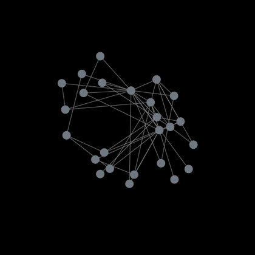 | **[Networks and layouts](advanced/30-network-layout.py)**<br>A network grown by Python, NetLogo's spring layout, nodes sized by degree.<br>[Details](https://bouaziznourddine.github.io/netlogopy/examples/#network-layout) |
| 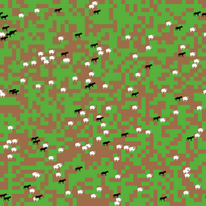 | **[Time series, headless](advanced/31-collect-data.py)**<br>`collect()` records Wolf Sheep at every step, as a dict or a DataFrame.<br>[Details](https://bouaziznourddine.github.io/netlogopy/examples/#collect-data) |
| 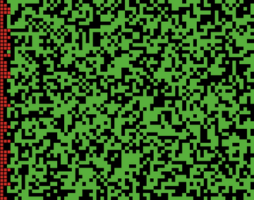 | **[A parameter sweep](advanced/32-experiment.py)**<br>`run_experiment()`: 21 Fire runs on 4 workers, the percolation threshold.<br>[Details](https://bouaziznourddine.github.io/netlogopy/examples/#experiment) |
| 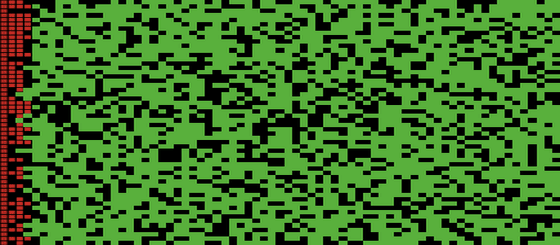 | **[Several models at once](advanced/33-two-models.py)**<br>Fire and Wolf Sheep in two threads of the same process.<br>[Details](https://bouaziznourddine.github.io/netlogopy/examples/#two-models) |
| 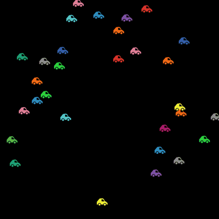 | **[Save and restore](advanced/34-export-import.py)**<br>Export the view, the plot and the world; restore the world.<br>[Details](https://bouaziznourddine.github.io/netlogopy/examples/#export-import) |
|  | **[Agents that write NETLOGOPY](advanced/45-draw-netlogopy.py)**<br>Nine turtles moved by Python along the strokes of the letters.<br>[Details](https://bouaziznourddine.github.io/netlogopy/examples/#draw-netlogopy) |

## The 0.x API

| | |
|---|---|
| 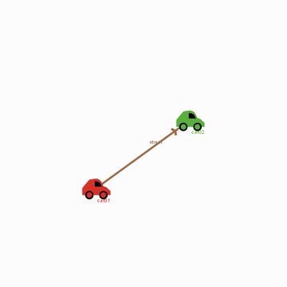 | **[First agents](simple/1-first-agents.py)**<br>`run_netlogo`, `pyturtle`, `street`, a background image.<br>[Details](https://bouaziznourddine.github.io/netlogopy/examples/#first-agents) |
| 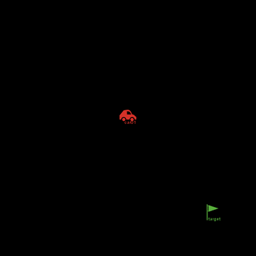 | **[Moving a turtle](simple/2-movement.py)**<br>`fd`, `rt`, `setxy`, `move_to`, `face_to`, distances.<br>[Details](https://bouaziznourddine.github.io/netlogopy/examples/#movement) |
|  | **[Appearance and drawing](simple/3-appearance.py)**<br>Colours, shapes, labels, the pen and stamps.<br>[Details](https://bouaziznourddine.github.io/netlogopy/examples/#appearance) |
| 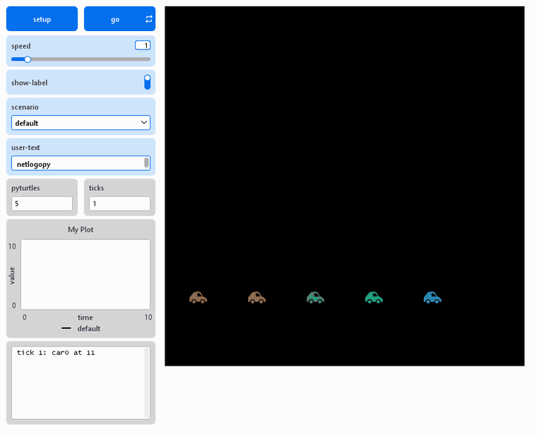 | **[Ticks, counting and output](simple/4-ticks-and-output.py)**<br>Ticks, the command center and the output area.<br>[Details](https://bouaziznourddine.github.io/netlogopy/examples/#ticks-and-output) |
| 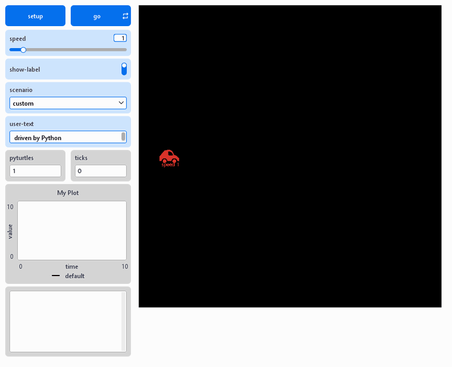 | **[Interface widgets](simple/5-widgets.py)**<br>Sliders, switches, choosers, inputs and monitors.<br>[Details](https://bouaziznourddine.github.io/netlogopy/examples/#widgets-0x) |
| 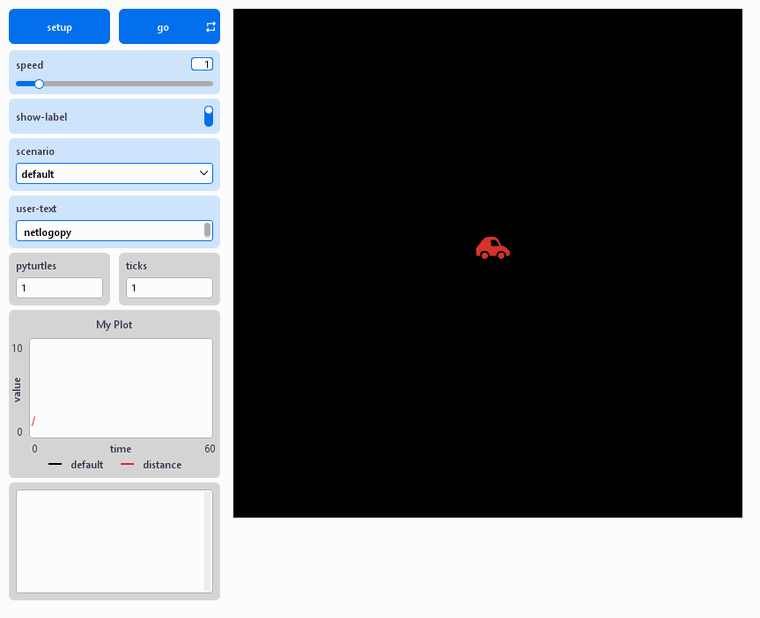 | **[Plotting from Python](simple/6-plot.py)**<br>Pens, colours and ranges of a NetLogo plot.<br>[Details](https://bouaziznourddine.github.io/netlogopy/examples/#plot-0x) |

The animations are recorded from the scripts themselves by `python tools/record_gifs.py`.
