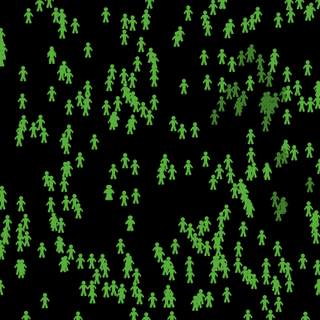
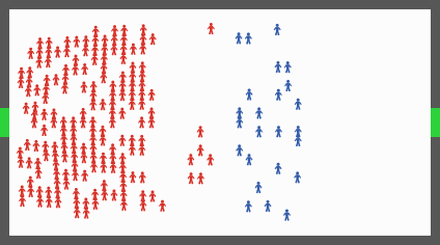
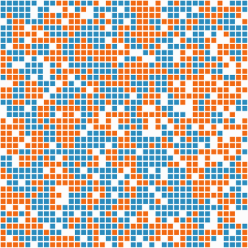
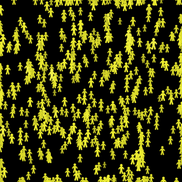
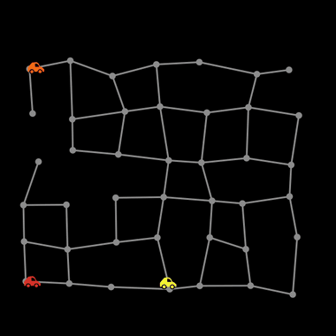

<h1 align="center">netlogopy</h1>

<p align="center">
  <b>Run NetLogo models from Python, and let Python decide, optimise, learn and measure inside the simulation.</b>
</p>

<p align="center">
  <a href="https://bouaziznourddine.github.io/netlogopy/"></a>
  <a href="https://github.com/bouaziznourddine/netlogopy/actions/workflows/tests.yml"></a>
  <a href="https://pypi.org/project/netlogopy/"></a>
  <a href="https://github.com/bouaziznourddine/netlogopy/blob/main/LICENSE"></a>
  <a href="https://doi.org/10.36819/SW25.019"></a>
</p>

<p align="center">
  
  
  
</p>

[NetLogo](https://ccl.northwestern.edu/netlogo/) is the simplest way to build
and watch an agent-based model; Python has the libraries for optimisation,
statistics and AI. netlogopy joins them: NetLogo runs **inside the Python
process**, in its own window or headless, and every NetLogo value, agent and
widget is reachable from Python.

```python
from netlogopy import NetLogo

with NetLogo("Wolf Sheep Predation.nlogo") as nl:    # headless by default
    nl.globals["initial-number-wolves"] = 40
    nl.setup()
    data = nl.collect({"sheep": "count sheep", "wolves": "count wolves"},
                      steps=200, as_dataframe=True)
```

**Documentation, tutorial and examples: <https://bouaziznourddine.github.io/netlogopy/>**

## Why netlogopy

- **Fast, in-process calls**: a call is a Java method call, not a message to a
  server (about 0.02–0.05 ms for a simple command or reporter). A Python loop
  can drive the model tick by tick.
- **Python values back**: numbers, strings, lists, agents, `None` for `nobody`.
- **Agents as Python objects**: `Turtle`, `Patch` and `Link`, with properties
  (`turtle.color = 15`) and methods (`forward`, `face`, `in_radius`, `hatch`...).
- **The NetLogo window, driven from Python**: watch the model while Python
  plays in it, add sliders, buttons and plots to its interface, press its
  buttons.
- **Background runs**: `start`, `pause`, `resume` and `stop` a model while
  Python keeps reading and changing it.
- **Experiments**: parameter sweeps with repetitions and seeds over parallel
  headless sessions (like BehaviorSpace), time series as dicts or pandas
  DataFrames.
- **Clear errors**: `NetLogoCompileError` and `NetLogoRuntimeError`, with the
  NetLogo code that failed.
- **NetLogo 6 and 7**, any model, MIT license.

How it compares with pynetlogo: [Why netlogopy](https://bouaziznourddine.github.io/netlogopy/why/).

## Installation

```bash
pip install netlogopy
```

Version 1.0 is not on PyPI yet; until it is, install it from GitHub:

```bash
pip install git+https://github.com/bouaziznourddine/netlogopy
```

Add `[data]` for pandas and numpy (`pip install "netlogopy[data]"`). You also
need [NetLogo](https://ccl.northwestern.edu/netlogo/download.shtml) 6.x or
7.x. netlogopy finds it by itself (`NETLOGO_HOME`, or the usual install
folders) and uses the Java runtime that comes with NetLogo 6.3 and newer; for
NetLogo 6.2 and older, install Java 11+ (for example
`conda install -c conda-forge openjdk=17`).

Check what netlogopy finds, and that NetLogo starts:

```bash
python -m netlogopy
```

Details: [Installation](https://bouaziznourddine.github.io/netlogopy/installation/).

## Quick start

```python
import time
from netlogopy import NetLogo, colors

nl = NetLogo(gui=True)               # the bundled model, in the NetLogo window
nl.setup()

cars = nl.create_turtles(8, "pyturtles", ordered=True, shape="car", size=4,
                         color=colors.RED, xcor=30, ycor=30)
for step in range(40):
    for car in cars:
        car.forward(0.5).right(3)
    nl.tick()
    time.sleep(0.05)

leader = cars[0]
leader.color = colors.BLUE
print(leader.in_radius(10, "pyturtles", other=True))   # a list of Turtle objects
print(nl.report("mean [xcor] of pyturtles"))            # a float
print(nl.report(["count turtles", "ticks"]))            # [8.0, 40.0]

nl.command("ask pyturtles with [xcor > 30] [ set color green ]")
nl.close()
```

`NetLogo(gui=False)`, the default, runs the same code without the window. Next
step: the [tutorial](https://bouaziznourddine.github.io/netlogopy/tutorial/),
a first simulation in five steps.

## Examples

In every example NetLogo simulates and shows the world, and Python decides,
optimises, learns or measures.

| | |
|---|---|
|  | **[A vaccination policy in an epidemic](https://github.com/bouaziznourddine/netlogopy/blob/main/Examples/advanced/38-python-policy.py)**: Python gives 6 doses every 5 ticks to the most exposed people; 50 people fall ill instead of 153. |
|  | **[Reinforcement learning in a maze](https://github.com/bouaziznourddine/netlogopy/blob/main/Examples/advanced/40-q-learning.py)**: NetLogo is the environment, a Python Q-table the learner; after 120 episodes the robot takes the shortest route. |
|  | **[Evacuating a room](https://github.com/bouaziznourddine/netlogopy/blob/main/Examples/advanced/43-evacuation.py)**: Python sends each person to the exit that gets them out soonest; 77 ticks instead of 92. |
|  | **[Schelling segregation](https://github.com/bouaziznourddine/netlogopy/blob/main/Examples/advanced/42-segregation.py)**: Python measures the segregation and finds the largest blocks by flood fill. |
|  | **[Inequality and a wealth tax](https://github.com/bouaziznourddine/netlogopy/blob/main/Examples/advanced/44-wealth-tax.py)**: a Python controller sets the tax from the Gini coefficient; 0.28 instead of 0.42. |
|  | **[Calibrating a model](https://github.com/bouaziznourddine/netlogopy/blob/main/Examples/advanced/39-calibrate-model.py)**: a bisection over 112 Fire runs in 4 parallel sessions finds the density that burns half the forest. |
|  | **[Routing cars](https://github.com/bouaziznourddine/netlogopy/blob/main/Examples/advanced/41-shortest-routes.py)**: Dijkstra in Python on the NetLogo road network, rerouting when a road closes. |

More, with the code of each one (agents, patches, networks, widgets, data
collection, parameter sweeps, background runs, existing models such as Wolf
Sheep and Fire): the [examples page](https://bouaziznourddine.github.io/netlogopy/examples/)
and the [`Examples`](https://github.com/bouaziznourddine/netlogopy/tree/main/Examples) folder.

```bash
python Examples/advanced/38-python-policy.py
```

Set `NETLOGOPY_HEADLESS=1` to run any example without the window.

## A short tour of the API

```python
from netlogopy import NetLogo, Code, run_experiment

nl = NetLogo("my_model.nlogo", gui=True)          # or headless: gui=False

# NetLogo code, Python values
nl.command("crt 10 [ setxy random-xcor random-ycor ]", "tick")
nl.report("count turtles")                        # 10.0
nl.report(["count turtles", "ticks"])             # several reporters in one call

# agents
wolves = nl.create_turtles(5, "wolves", color=15, xcor=Code("random-xcor"))
w = wolves[0]
w.forward(2).right(45)
w["energy"] = 5                                   # any turtles-own variable
nl.turtles("sheep", where="energy > 5")

# globals, widgets, simulation
nl.globals["initial-number-sheep"] = 100
nl.setup(); nl.go(100)
nl.run_until("not any? wolves", max_steps=1000)
nl.start("go", interval=0.05); nl.pause(); nl.resume(); nl.stop()

# interface widgets, added from Python (window only)
nl.add_slider("walkers", 1, 200, 50, 1)
nl.add_button("walk", "ask turtles [ fd 1 ]", forever=True)

# data and experiments
grid = nl.patch_grid("pcolor", as_array=True)
rows = run_experiment("Fire.nlogo", parameters={"density": [50, 60, 70]},
                      reporters={"burned": "burned-trees"},
                      repetitions=10, steps=2000, workers=4, as_dataframe=True)
```

Everything else is in the [guide](https://bouaziznourddine.github.io/netlogopy/guide/sessions/)
and the [API reference](https://bouaziznourddine.github.io/netlogopy/api/).

## Compatibility

- Python 3.8 or newer; [JPype1](https://pypi.org/project/JPype1/) is
  installed automatically.
- NetLogo 6.x and 7.x, tested with 6.2.2, 6.3.0 and 7.0.0 on Windows and with
  6.4.0 and 7.0.0 on Linux.
- On macOS, headless sessions work; the NetLogo window does not (Java's AWT
  needs the main thread there).
- Scripts written for netlogopy 0.x (`run_netlogo`, `pyturtle`, `street`...)
  keep working, and the code of the SW25 paper runs as printed: see
  [The 0.x API](https://bouaziznourddine.github.io/netlogopy/guide/legacy/)
  and the [changelog](https://github.com/bouaziznourddine/netlogopy/blob/main/CHANGELOG.md).

## Development

```bash
pip install -e ".[test,data]"
```

```bash
pytest
```

The tests are skipped when NetLogo or Java is missing; `pytest -m examples`
runs every example headless. The documentation is built from `docs/` with
MkDocs Material (`pip install -r docs/requirements.txt`, then `mkdocs serve`),
and `python tools/record_gifs.py` records the animations again from the
example scripts.

Questions, issues and ideas are welcome on the
[issue tracker](https://github.com/bouaziznourddine/netlogopy/issues).

## Citation

If you use netlogopy in your research, please cite:

> Nourddine Bouaziz, Belgacem Bettayeb, M'Hammed Sahnoun, Adnan Yassine.
> *Netlogopy: Unlocking Advanced Simulation and Integration for NetLogo Using
> Python.* Simulation Workshop 2025 (SW25), March 2025, Exeter, United Kingdom.
> [doi:10.36819/SW25.019](https://doi.org/10.36819/SW25.019) —
> [hal-04982069](https://hal.science/hal-04982069)
> ([PDF](https://github.com/bouaziznourddine/netlogopy/blob/main/paper/netlogopy-SW25-paper.pdf))

```bibtex
@inproceedings{bouaziz2025netlogopy,
  title     = {Netlogopy: Unlocking Advanced Simulation and Integration for {NetLogo} Using {Python}},
  author    = {Bouaziz, Nourddine and Bettayeb, Belgacem and Sahnoun, M'hammed and Yassine, Adnan},
  booktitle = {Proceedings of the Operational Research Society Simulation Workshop 2025 ({SW25})},
  address   = {Exeter, United Kingdom},
  year      = {2025},
  doi       = {10.36819/SW25.019}
}
```

## License

netlogopy is under the [MIT License](https://github.com/bouaziznourddine/netlogopy/blob/main/LICENSE). It does not include NetLogo:
it uses the NetLogo you install (GNU GPL, version 2 or later) and JPype
(Apache 2.0), which allows using netlogopy with NetLogo for research and for
commercial work. If you distribute a program that bundles NetLogo itself, the
GPL applies to that distribution.

The Fire and Wolf Sheep Predation models in `Examples/complexe` come from the
NetLogo Models Library (Copyright 1997 Uri Wilensky,
[CC BY-NC-SA 3.0](https://creativecommons.org/licenses/by-nc-sa/3.0/)).

Developed by **Nourddine Bouaziz** ([@bouaziznourddine](https://github.com/bouaziznourddine)).
