# Examples

Every example is a script in the
[`Examples`](https://github.com/bouaziznourddine/netlogopy/tree/main/Examples)
folder of the repository. They open the NetLogo window; with
`NETLOGOPY_HEADLESS=1` they run without it.

```bash
python Examples/advanced/28-quickstart.py
```

The animations below are recorded from the scripts themselves by
`tools/record_gifs.py`.

## Applications

Python takes part in the simulation in every domain: epidemiology, AI,
crowds, social science, economics, ecology, traffic, fire spread. In each
example NetLogo simulates and shows the world, and Python decides, optimises,
learns or measures.

### A Python policy inside an epidemic { #python-policy }

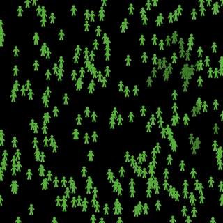{ .demo width="320" }

[`advanced/38-python-policy.py`](https://github.com/bouaziznourddine/netlogopy/blob/main/Examples/advanced/38-python-policy.py)
- NetLogo simulates the epidemic (green healthy, red sick, blue immune);
every 5 ticks, Python decides who receives one of its 6 vaccine doses. The
NetLogo model itself is written by the Python script.

| Policy | Peak of sick people | People who fell ill |
|---|---|---|
| no vaccination | 77 | 153 |
| random doses | 67 | 112 |
| doses to the most exposed | 30 | 50 |

??? example "Code"

    ```python title="advanced/38-python-policy.py"
    --8<-- "Examples/advanced/38-python-policy.py"
    ```

### Reinforcement learning in a NetLogo maze { #q-learning }

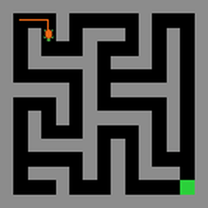{ .demo width="340" }

[`advanced/40-q-learning.py`](https://github.com/bouaziznourddine/netlogopy/blob/main/Examples/advanced/40-q-learning.py)
- NetLogo is the environment (the maze, the moves), Python is the learner (a
Q-learning table, rewards, exploration). Every 20 episodes the robot shows,
pen down, what it has learned; until it has learned enough it goes round in
circles and the demonstration stops. After 120 episodes it takes the shortest
route, 32 moves.

??? example "Code"

    ```python title="advanced/40-q-learning.py"
    --8<-- "Examples/advanced/40-q-learning.py"
    ```

### Evacuating a room { #evacuation }

{ .demo width="440" }

[`advanced/43-evacuation.py`](https://github.com/bouaziznourddine/netlogopy/blob/main/Examples/advanced/43-evacuation.py)
- a crowd leaves a hall with two exits; NetLogo moves the people and lets two
of them through each exit per tick. Python chooses the exits: everybody to the
nearest one (red), or, every 3 ticks, each person to the exit that gets them
out soonest given the queue (blue).

| Policy | Evacuation time |
|---|---|
| nearest exit | 92 ticks |
| exits balanced by Python | 77 ticks |

??? example "Code"

    ```python title="advanced/43-evacuation.py"
    --8<-- "Examples/advanced/43-evacuation.py"
    ```

### Segregation, measured by Python { #segregation }

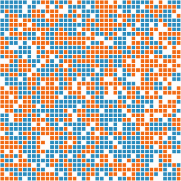{ .demo width="360" }

[`advanced/42-segregation.py`](https://github.com/bouaziznourddine/netlogopy/blob/main/Examples/advanced/42-segregation.py)
- Schelling's model: a person moves when too few neighbours belong to their
group. NetLogo runs the moves; after each step Python reads the whole city in
one call, measures the segregation and finds, by a flood fill, the largest
block of each group, which it then shows darker on the view.

| Wanted share of own group | Same-group neighbours, start -> end | Largest block |
|---|---|---|
| 30 % | 51 % -> 76 % | 297 people |
| 50 % | 51 % -> 88 % | 566 people |

Even people who accept being a minority end up in a segregated city.

??? example "Code"

    ```python title="advanced/42-segregation.py"
    --8<-- "Examples/advanced/42-segregation.py"
    ```

### Inequality and a tax set by Python { #wealth-tax }

{ .demo width="300" }

[`advanced/44-wealth-tax.py`](https://github.com/bouaziznourddine/netlogopy/blob/main/Examples/advanced/44-wealth-tax.py)
- 500 people start with 25 coins and give one coin per tick to someone nearby.
Nobody is favoured, yet wealth becomes unequal (bigger and brighter: richer).
Python computes the Gini coefficient every 10 ticks and sets a wealth tax with
a proportional controller to keep it near 0.25.

| Policy | Gini | Richest 10 % own | Tax rate |
|---|---|---|---|
| no tax | 0.42 | 26 % | 0 % |
| regulated by Python | 0.28 | 20 % | 13.1 % |

??? example "Code"

    ```python title="advanced/44-wealth-tax.py"
    --8<-- "Examples/advanced/44-wealth-tax.py"
    ```

### Calibrating a model with a Python optimiser { #calibrate }

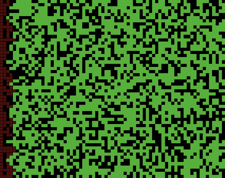{ .demo width="380" }

[`advanced/39-calibrate-model.py`](https://github.com/bouaziznourddine/netlogopy/blob/main/Examples/advanced/39-calibrate-model.py)
- which tree density makes the fire burn half of the forest? A bisection in
Python proposes densities; each one is scored by 16 runs of the Fire model in
4 parallel headless sessions (112 runs in about 10 s). It finds 60.1 %, close
to the percolation threshold of the square lattice (about 59 %), where the
fire goes from dying out to crossing the forest. The model then runs in the
window at that density.

??? example "Code"

    ```python title="advanced/39-calibrate-model.py"
    --8<-- "Examples/advanced/39-calibrate-model.py"
    ```

### Designs, sensitivity and calibration { #sensitivity }

[`advanced/46-sensitivity.py`](https://github.com/bouaziznourddine/netlogopy/blob/main/Examples/advanced/46-sensitivity.py)
- three questions about Wolf Sheep Predation, one function each. A Latin
hypercube of 24 parameter sets covers three sliders and runs in parallel;
`sensitivity()` gives the share of the variation of the number of sheep that
each slider explains (sheep reproduction first); `calibrate()` finds, in 48
runs, the slider values that give 150 sheep after 30 ticks.

??? example "Code"

    ```python title="advanced/46-sensitivity.py"
    --8<-- "Examples/advanced/46-sensitivity.py"
    ```

### A model as a Gymnasium environment { #gym }

[`advanced/47-gym-environment.py`](https://github.com/bouaziznourddine/netlogopy/blob/main/Examples/advanced/47-gym-environment.py)
- the Fire model as an environment for reinforcement learning: the agent
sees the burned trees and the fires, and waits or puts two fires out. Two
fixed policies are compared over three seeds: fighting when more than 5 fires
burn leaves 360 burned trees on average instead of 1359. A learning library
takes the same environment as it is.

??? example "Code"

    ```python title="advanced/47-gym-environment.py"
    --8<-- "Examples/advanced/47-gym-environment.py"
    ```

### A language model that manages the model { #language-model }

[`advanced/48-language-model-agent.py`](https://github.com/bouaziznourddine/netlogopy/blob/main/Examples/advanced/48-language-model-agent.py)
- a park warden looks at Wolf Sheep Predation every 25 ticks and culls or
releases animals so that no species dies out. The warden is a Python
function: a fixed rule by default, or Claude through the Anthropic API when
`NETLOGOPY_LLM=1` is set (each decision is then a paid request).

??? example "Code"

    ```python title="advanced/48-language-model-agent.py"
    --8<-- "Examples/advanced/48-language-model-agent.py"
    ```

### Routing cars on a road network { #routes }

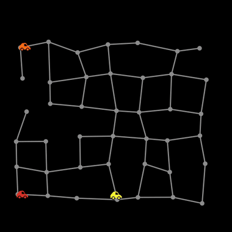{ .demo width="380" }

[`advanced/41-shortest-routes.py`](https://github.com/bouaziznourddine/netlogopy/blob/main/Examples/advanced/41-shortest-routes.py)
- the intersections are turtles and the roads links; Python reads the network
in one call, computes the shortest routes with Dijkstra and gives them to the
cars. At tick 25 a road on a car's route is closed (in red) and Python
reroutes the cars that were going to use it.

??? example "Code"

    ```python title="advanced/41-shortest-routes.py"
    --8<-- "Examples/advanced/41-shortest-routes.py"
    ```

### Start, pause, change and stop { #start-pause-stop }

{ .demo width="340" }

[`advanced/37-start-pause-stop.py`](https://github.com/bouaziznourddine/netlogopy/blob/main/Examples/advanced/37-start-pause-stop.py)
- Wolf Sheep Predation runs in the background with `start()`. Python watches
it, pauses it when the sheep population explodes, makes the wolves more
efficient (in red), and resumes it.

??? example "Code"

    ```python title="advanced/37-start-pause-stop.py"
    --8<-- "Examples/advanced/37-start-pause-stop.py"
    ```

### Python agents in existing NetLogo models { #existing-models }

<div class="demo-grid" markdown>
<figure markdown>
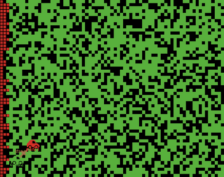
<figcaption><a href="https://github.com/bouaziznourddine/netlogopy/blob/main/Examples/complexe/Fire/Fire.py">complexe/Fire/Fire.py</a>: the Fire model, with two cars and a street driven by Python</figcaption>
</figure>
<figure markdown>
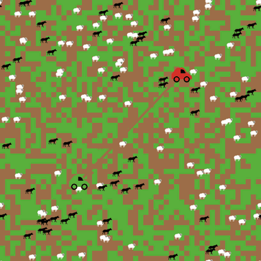
<figcaption><a href="https://github.com/bouaziznourddine/netlogopy/blob/main/Examples/complexe/Wolf%20Sheep/Wolf.py">complexe/Wolf Sheep/Wolf.py</a>: Wolf Sheep Predation, the same way</figcaption>
</figure>
</div>

[`complexe/27-external-model.py`](https://github.com/bouaziznourddine/netlogopy/blob/main/Examples/complexe/27-external-model.py)
{ .demo width="340" }

explains the steps: include `base.nls`, open the model without running its
`setup`, set its widgets, add Python agents. See
[Your own models](guide/models.md).

??? example "Code: Fire.py"

    ```python title="complexe/Fire/Fire.py"
    --8<-- "Examples/complexe/Fire/Fire.py"
    ```

??? example "Code: Wolf.py"

    ```python title="complexe/Wolf Sheep/Wolf.py"
    --8<-- "Examples/complexe/Wolf Sheep/Wolf.py"
    ```

??? example "Code: 27-external-model.py"

    ```python title="complexe/27-external-model.py"
    --8<-- "Examples/complexe/27-external-model.py"
    ```

### Interface widgets added from Python { #widgets }

{ .demo }

[`advanced/36-add-widgets.py`](https://github.com/bouaziznourddine/netlogopy/blob/main/Examples/advanced/36-add-widgets.py)
- a note, two sliders, a switch, a chooser, two buttons (one forever), a
monitor and a plot are added to the interface; Python sets them and presses
the buttons.

??? example "Code"

    ```python title="advanced/36-add-widgets.py"
    --8<-- "Examples/advanced/36-add-widgets.py"
    ```

## The `NetLogo` class

One example per part of the API, from the first session to saving the
model state. Each one runs in a few seconds.

### Quick start { #quickstart }

{ .demo width="340" }

[`advanced/28-quickstart.py`](https://github.com/bouaziznourddine/netlogopy/blob/main/Examples/advanced/28-quickstart.py):
eight cars start at the centre with evenly spread headings and drive a
circle, moved by Python (`car.forward(0.5).right(3)`: the methods can be
chained). Python then makes the first car the blue "leader", asks which cars
are near it, and reads NetLogo values as Python values: a float for
`mean [xcor] of pyturtles`, a list for several reporters at once, a `Turtle`
for `min-one-of`. A NetLogo command finally paints green the cars east of
the centre.

**Uses** `NetLogo(gui=True)`, `create_turtles`, `Turtle.forward` / `right`,
turtle properties (`color`, `label`, `xy`, `heading`), `in_radius`, `report`,
`command`, `count`.

??? example "Code"

    ```python title="advanced/28-quickstart.py"
    --8<-- "Examples/advanced/28-quickstart.py"
    ```

### Patches as a grid { #patches-grid }

{ .demo width="300" }

[`advanced/29-patches-grid.py`](https://github.com/bouaziznourddine/netlogopy/blob/main/Examples/advanced/29-patches-grid.py):
Python builds a picture as a list of rows (a bright square in the middle)
and writes it into `pcolor` for the whole world in one call. NetLogo's
`diffuse` spreads it over 30 ticks; Python reads the grid back, also in one
call, and measures it: 377 patches are still brighter than 0.5. Patches are
agents too: the corner patch gets a colour and a label, and Python lists its
neighbours.

**Uses** `set_patch_grid`, `diffuse`, `patch_grid` (lists, or NumPy arrays
with `as_array=True`), `patch`, `Patch.neighbors`, `count`.

??? example "Code"

    ```python title="advanced/29-patches-grid.py"
    --8<-- "Examples/advanced/29-patches-grid.py"
    ```

### Networks and layouts { #network-layout }

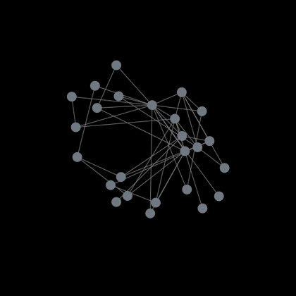{ .demo width="320" }

[`advanced/30-network-layout.py`](https://github.com/bouaziznourddine/netlogopy/blob/main/Examples/advanced/30-network-layout.py):
Python grows a network of 25 nodes by preferential attachment (each new node
links to two nodes chosen in proportion to their degree); NetLogo places
them on a circle, then relaxes the spring layout step by step. The degree of
every node is read in one call: the node size follows the degree and the
hubs (6 links or more) turn red. The run prints 45 links and a hub with 13
links.

**Uses** `create_turtles`, `create_link`, `Turtle.create_link_with`,
`layout_circle`, `layout_spring`, `of`, `Turtle.link_neighbors`.

??? example "Code"

    ```python title="advanced/30-network-layout.py"
    --8<-- "Examples/advanced/30-network-layout.py"
    ```

### Time series, headless { #collect-data }

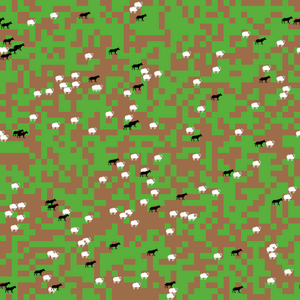{ .demo width="300" }

[`advanced/31-collect-data.py`](https://github.com/bouaziznourddine/netlogopy/blob/main/Examples/advanced/31-collect-data.py):
Wolf Sheep Predation runs without a window, with grass, 40 wolves and a
fixed random seed. `collect()` records three reporters at every step (sheep,
wolves, grass) for 300 steps, or until one species is gone, and returns a
dict of lists, or a pandas DataFrame. In this run the sheep go between 98
and 242 and the wolves between 21 and 107, in cycles. The animation is the
view of the headless run, saved by the documentation tools.

**Uses** `NetLogo(model)` (headless), `globals`, `random_seed`, `collect`.

??? example "Code"

    ```python title="advanced/31-collect-data.py"
    --8<-- "Examples/advanced/31-collect-data.py"
    ```

### A parameter sweep { #experiment }

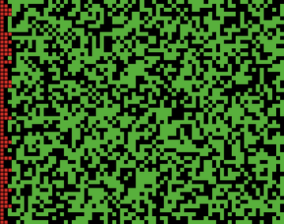{ .demo width="300" }

[`advanced/32-experiment.py`](https://github.com/bouaziznourddine/netlogopy/blob/main/Examples/advanced/32-experiment.py):
how much of the forest burns, for each tree density? `run_experiment()` runs
the Fire model for 7 densities, 3 times each (21 runs), on 4 headless
sessions in parallel, and stops each run as soon as the fire is out, like
BehaviorSpace. The script then shows in the window one fire below, near and
above the threshold (the animation: 55, 60 and 65 %).

| Density | 50 | 55 | 58 | 60 | 62 | 65 | 70 |
|---|---|---|---|---|---|---|---|
| Forest burned (mean of 3 runs) | 9 % | 13 % | 36 % | 55 % | 87 % | 91 % | 97 % |

Between 55 and 62 % the answer jumps: this is the percolation threshold of
the square lattice (about 59 %).

**Uses** `run_experiment` (`parameters`, `repetitions`, `until`, `seed`,
`workers`, `progress`), then `globals`, `setup`, `go`, `report`.

??? example "Code"

    ```python title="advanced/32-experiment.py"
    --8<-- "Examples/advanced/32-experiment.py"
    ```

### Several models at once { #two-models }

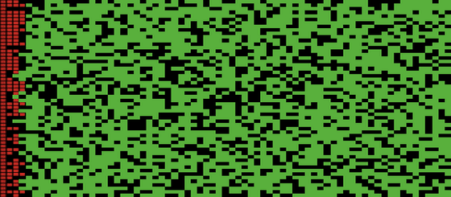{ .demo width="480" }

[`advanced/33-two-models.py`](https://github.com/bouaziznourddine/netlogopy/blob/main/Examples/advanced/33-two-models.py):
two different models, Fire and Wolf Sheep Predation, run at the same time in
the same Python process, each in its own thread and its own headless
session. The animation puts their two views side by side as they advance.
One process can hold any number of headless sessions, and one NetLogo window.

**Uses** `NetLogo(model)` in a `threading.Thread`, `globals`, `go`, `report`
with a list of reporters.

??? example "Code"

    ```python title="advanced/33-two-models.py"
    --8<-- "Examples/advanced/33-two-models.py"
    ```

### Save and restore { #export-import }

{ .demo width="300" }

[`advanced/34-export-import.py`](https://github.com/bouaziznourddine/netlogopy/blob/main/Examples/advanced/34-export-import.py):
thirty cars wander for 10 ticks while Python plots their mean position.
Python then exports an image of the view, the plot as CSV and the whole
model state, clears everything, imports the state again and checks that
every car is back at the same place, with the same ticks.

**Uses** `create_turtles` with `Code("random-xcor")`, `ask`, `plot`,
`export_view`, `export_plot`, `export_world`, `clear_all`, `import_world`,
`of`.

??? example "Code"

    ```python title="advanced/34-export-import.py"
    --8<-- "Examples/advanced/34-export-import.py"
    ```

### Agents that write NETLOGOPY { #draw-netlogopy }

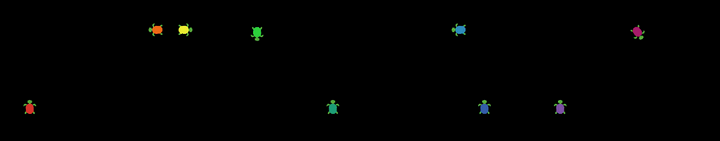{ .demo width="560" }

[`advanced/45-draw-netlogopy.py`](https://github.com/bouaziznourddine/netlogopy/blob/main/Examples/advanced/45-draw-netlogopy.py):
nine turtles, one per letter, write the word together in 93 ticks. Each
letter is a list of strokes on a 4 x 6 grid, held in Python; at every tick
Python moves each turtle 0.6 patch further along its strokes, pen down on a
stroke and pen up between two strokes. NetLogo draws the lines.

**Uses** `resize_world`, `set_patch_size`, `create_turtles`, `pen_size`,
`pen_down` / `pen_up`, `facexy`, `setxy`, `hide_turtle`.

??? example "Code"

    ```python title="advanced/45-draw-netlogopy.py"
    --8<-- "Examples/advanced/45-draw-netlogopy.py"
    ```

## The 0.x API

The examples of netlogopy 0.x, unchanged: scripts written for 0.x keep
working with 1.0 (see [The 0.x API](guide/legacy.md)). They use the bundled
model and its `pyturtles` and `streets` breeds.

### First agents { #first-agents }

{ .demo width="300" }

[`simple/1-first-agents.py`](https://github.com/bouaziznourddine/netlogopy/blob/main/Examples/simple/1-first-agents.py):
opens the bundled model in the NetLogo window, resizes the world, puts an
image behind it and creates two Python-driven turtles (`pyturtle`) joined by
a `street`.

**Uses** `run_netlogo`, `resize_world`, `set_background`, `pyturtle`,
`street`, `close_model`.

??? example "Code"

    ```python title="simple/1-first-agents.py"
    --8<-- "Examples/simple/1-first-agents.py"
    ```

### Moving a turtle { #movement }

{ .demo width="300" }

[`simple/2-movement.py`](https://github.com/bouaziznourddine/netlogopy/blob/main/Examples/simple/2-movement.py):
forward and back, turns, headings, jumps to a point or to another turtle,
facing a turtle, and the positions and distances read back in Python.

**Uses** `fd`, `bk`, `rt`, `lt`, `set_heading`, `get_heading`, `setxy`,
`move_to`, `face_to`, `getxyturtle`, `distanceto`, `distancebetween`.

??? example "Code"

    ```python title="simple/2-movement.py"
    --8<-- "Examples/simple/2-movement.py"
    ```

### Appearance and drawing { #appearance }

{ .demo width="300" }

[`simple/3-appearance.py`](https://github.com/bouaziznourddine/netlogopy/blob/main/Examples/simple/3-appearance.py):
colours, sizes, shapes and labels of a turtle, hiding and showing it, and
drawing with its pen (lines and stamps), then clearing the drawing.

**Uses** `set_color`, `get_color`, `set_size`, `get_size`, `set_shape`,
`set_label`, `hideturtle`, `showturtle`, `pen_down`, `pen_up`, `stamp`,
`clear_drawing`.

??? example "Code"

    ```python title="simple/3-appearance.py"
    --8<-- "Examples/simple/3-appearance.py"
    ```

### Ticks, counting and output { #ticks-and-output }

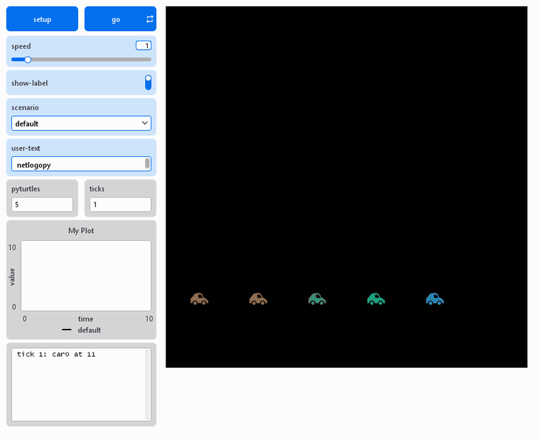{ .demo }

[`simple/4-ticks-and-output.py`](https://github.com/bouaziznourddine/netlogopy/blob/main/Examples/simple/4-ticks-and-output.py):
advances the simulation clock, counts the Python turtles, and writes to the
command center and to the output area of the interface.

**Uses** `do_tick`, `get_ticks`, `reset_ticks`, `count_pyturtles`,
`get_all_pyturtles`, `netlogoshow`, `nl_output_print`, `run_command`.

??? example "Code"

    ```python title="simple/4-ticks-and-output.py"
    --8<-- "Examples/simple/4-ticks-and-output.py"
    ```

### Interface widgets { #widgets-0x }

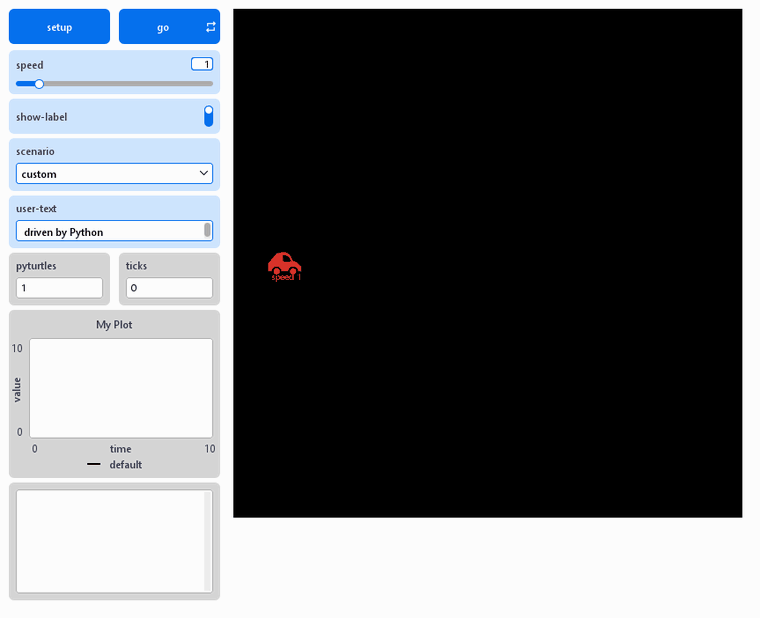{ .demo }

[`simple/5-widgets.py`](https://github.com/bouaziznourddine/netlogopy/blob/main/Examples/simple/5-widgets.py):
reads and sets the widgets of the bundled model (the speed slider, the
show-label switch, the scenario chooser, the user-text input) and evaluates
monitor expressions.

**Uses** `get_slider`, `set_slider`, `get_switch`, `set_switch`,
`get_chooser`, `set_chooser`, `get_input_box`, `set_input_box`,
`get_monitor`.

??? example "Code"

    ```python title="simple/5-widgets.py"
    --8<-- "Examples/simple/5-widgets.py"
    ```

### Plotting from Python { #plot-0x }

{ .demo }

[`simple/6-plot.py`](https://github.com/bouaziznourddine/netlogopy/blob/main/Examples/simple/6-plot.py):
a car drives a circle while Python draws, in the "My Plot" widget, its
distance to the centre, with its own pen, colour, mode and ranges.

**Uses** `set_current_plot`, `create_plot_pen`, `set_plot_pen`,
`set_plot_pen_color`, `set_plot_pen_mode`, `set_plot_x_range`,
`set_plot_y_range`, `plot_add`, `plot_xy`.

??? example "Code"

    ```python title="simple/6-plot.py"
    --8<-- "Examples/simple/6-plot.py"
    ```
