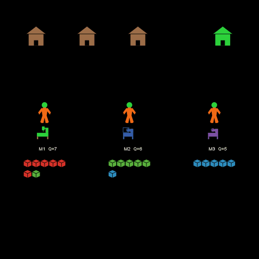
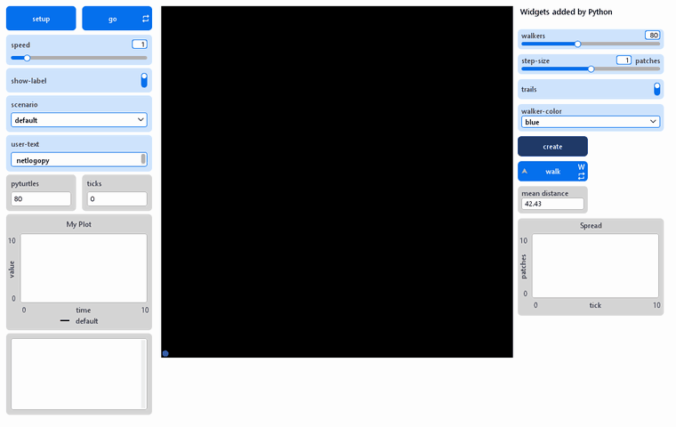

# Examples

Every example is a script in the
[`Examples`](https://github.com/bouaziznourddine/netlogopy/tree/main/Examples)
folder of the repository. They open the NetLogo window; with
`NETLOGOPY_HEADLESS=1` they run without it.

```bash
python Examples/advanced/28-quickstart.py
```

The animations below are recorded from the scripts themselves by
`tools/record_gifs.py`.

## Applications

### Job shop with human operators { #job-shop }

{ .demo width="460" }

[`advanced/35-job-shop.py`](https://github.com/bouaziznourddine/netlogopy/blob/main/Examples/advanced/35-job-shop.py)
- the application presented at SW25. Each machine has an operator whose
punctuality (a Markov chain between the machine and three non-productive
zones), fatigue and experience set the processing speed. NetLogo shows the
workshop; Python holds the model and re-optimises the machine queues every 20
ticks. Two strategies are compared on the same scenario:

| Strategy | Jobs finished | Mean flow time |
|---|---|---|
| first in, first out | 18 / 18 | 164.2 ticks |
| shortest remaining work first | 18 / 18 | 146.6 ticks |

With matplotlib installed, a Gantt chart of each run is saved in
`./netlogopy-output/`.

### A Python policy inside an epidemic { #python-policy }

{ .demo width="320" }

[`advanced/38-python-policy.py`](https://github.com/bouaziznourddine/netlogopy/blob/main/Examples/advanced/38-python-policy.py)
- NetLogo simulates the epidemic (green healthy, red sick, blue immune);
every 5 ticks, Python decides who receives one of its 6 vaccine doses. The
NetLogo model itself is written by the Python script.

| Policy | Peak of sick people | People who fell ill |
|---|---|---|
| no vaccination | 77 | 153 |
| random doses | 67 | 112 |
| doses to the most exposed | 30 | 50 |

### Start, pause, change and stop { #start-pause-stop }

{ .demo width="340" }

[`advanced/37-start-pause-stop.py`](https://github.com/bouaziznourddine/netlogopy/blob/main/Examples/advanced/37-start-pause-stop.py)
- Wolf Sheep Predation runs in the background with `start()`. Python watches
it, pauses it when the sheep population explodes, makes the wolves more
efficient (in red), and resumes it.

### Python agents in existing NetLogo models { #existing-models }

<div class="demo-grid" markdown>
<figure markdown>

<figcaption><a href="https://github.com/bouaziznourddine/netlogopy/blob/main/Examples/complexe/Fire/Fire.py">complexe/Fire/Fire.py</a>: the Fire model, with two cars and a street driven by Python</figcaption>
</figure>
<figure markdown>

<figcaption><a href="https://github.com/bouaziznourddine/netlogopy/blob/main/Examples/complexe/Wolf%20Sheep/Wolf.py">complexe/Wolf Sheep/Wolf.py</a>: Wolf Sheep Predation, the same way</figcaption>
</figure>
</div>

[`complexe/27-external-model.py`](https://github.com/bouaziznourddine/netlogopy/blob/main/Examples/complexe/27-external-model.py)
explains the steps: include `base.nls`, open the model without running its
`setup`, set its widgets, add Python agents. See
[Your own models](guide/models.md).

### Interface widgets added from Python { #widgets }

{ .demo }

[`advanced/36-add-widgets.py`](https://github.com/bouaziznourddine/netlogopy/blob/main/Examples/advanced/36-add-widgets.py)
- a note, two sliders, a switch, a chooser, two buttons (one forever), a
monitor and a plot are added to the interface; Python sets them and presses
the buttons.

## The `NetLogo` class

| | Script | Shows |
|---|---|---|
| { width="160" } | [`advanced/28-quickstart.py`](https://github.com/bouaziznourddine/netlogopy/blob/main/Examples/advanced/28-quickstart.py) | agents as objects, `command`, `report`, typed results |
| { width="160" } | [`advanced/29-patches-grid.py`](https://github.com/bouaziznourddine/netlogopy/blob/main/Examples/advanced/29-patches-grid.py) | a whole patch variable as a grid, `diffuse` |
| { width="160" } | [`advanced/30-network-layout.py`](https://github.com/bouaziznourddine/netlogopy/blob/main/Examples/advanced/30-network-layout.py) | a scale-free network, `layout_spring`, degrees |
| | [`advanced/31-collect-data.py`](https://github.com/bouaziznourddine/netlogopy/blob/main/Examples/advanced/31-collect-data.py) | time series with `collect()`, headless, pandas |
| | [`advanced/32-experiment.py`](https://github.com/bouaziznourddine/netlogopy/blob/main/Examples/advanced/32-experiment.py) | a parameter sweep with `run_experiment()` on 4 workers |
| | [`advanced/33-two-models.py`](https://github.com/bouaziznourddine/netlogopy/blob/main/Examples/advanced/33-two-models.py) | two models at once, in two threads |
| | [`advanced/34-export-import.py`](https://github.com/bouaziznourddine/netlogopy/blob/main/Examples/advanced/34-export-import.py) | export the view, the plots and the world; restore the world |

## The 0.x API

| | Script | Functions |
|---|---|---|
| | [`simple/1-first-agents.py`](https://github.com/bouaziznourddine/netlogopy/blob/main/Examples/simple/1-first-agents.py) | `run_netlogo`, `resize_world`, `set_background`, `pyturtle`, `street` |
| { width="160" } | [`simple/2-movement.py`](https://github.com/bouaziznourddine/netlogopy/blob/main/Examples/simple/2-movement.py) | `fd`, `bk`, `rt`, `lt`, `set_heading`, `setxy`, `move_to`, `face_to`, `getxyturtle`, `distanceto`, `distancebetween` |
| { width="160" } | [`simple/3-appearance.py`](https://github.com/bouaziznourddine/netlogopy/blob/main/Examples/simple/3-appearance.py) | `set_color`, `set_size`, `set_shape`, `set_label`, `hideturtle`, `showturtle`, `pen_down`, `pen_up`, `stamp` |
| | [`simple/4-ticks-and-output.py`](https://github.com/bouaziznourddine/netlogopy/blob/main/Examples/simple/4-ticks-and-output.py) | `do_tick`, `get_ticks`, `count_pyturtles`, `netlogoshow`, `nl_output_print`, `run_command` |
| | [`simple/5-widgets.py`](https://github.com/bouaziznourddine/netlogopy/blob/main/Examples/simple/5-widgets.py) | `get_slider`, `set_slider`, `get_switch`, `set_switch`, `get_chooser`, `set_chooser`, `get_input_box`, `set_input_box`, `get_monitor` |
| | [`simple/6-plot.py`](https://github.com/bouaziznourddine/netlogopy/blob/main/Examples/simple/6-plot.py) | `set_current_plot`, `create_plot_pen`, `set_plot_pen`, `set_plot_pen_color`, `plot_add`, `plot_xy` |
