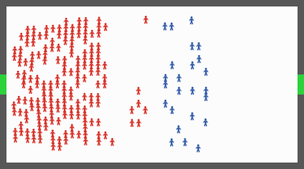
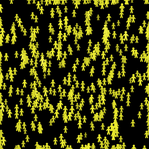
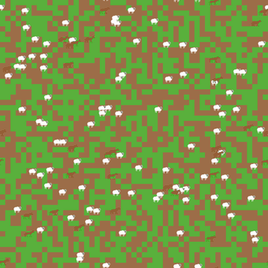
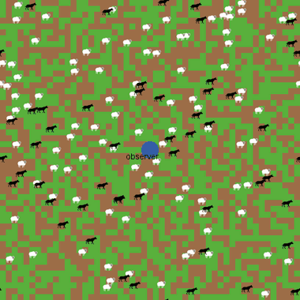
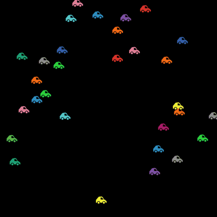
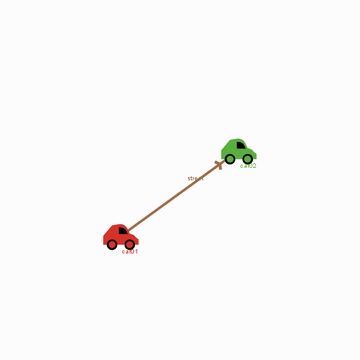
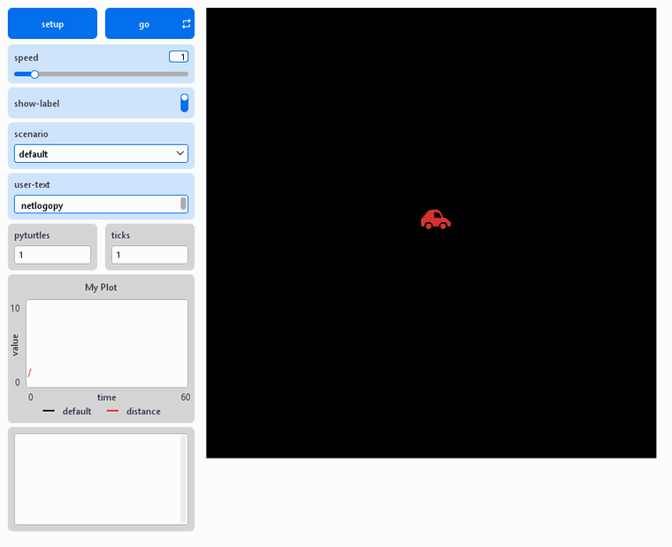

# Examples

Every example is a script in the
[`Examples`](https://github.com/bouaziznourddine/netlogopy/tree/main/Examples)
folder of the repository. They open the NetLogo window; with
`NETLOGOPY_HEADLESS=1` they run without it.

```bash
python Examples/advanced/28-quickstart.py
```

The animations below are recorded from the scripts themselves by
`tools/record_gifs.py`.

## Applications

Python takes part in the simulation in every domain: epidemiology, AI,
crowds, social science, economics, ecology, traffic, fire spread. In each
example NetLogo simulates and shows the world, and Python decides, optimises,
learns or measures.

### A Python policy inside an epidemic { #python-policy }

{ .demo width="320" }

[`advanced/38-python-policy.py`](https://github.com/bouaziznourddine/netlogopy/blob/main/Examples/advanced/38-python-policy.py)
- NetLogo simulates the epidemic (green healthy, red sick, blue immune);
every 5 ticks, Python decides who receives one of its 6 vaccine doses. The
NetLogo model itself is written by the Python script.

| Policy | Peak of sick people | People who fell ill |
|---|---|---|
| no vaccination | 77 | 153 |
| random doses | 67 | 112 |
| doses to the most exposed | 30 | 50 |

??? example "Code"

    ```python title="advanced/38-python-policy.py"
    --8<-- "Examples/advanced/38-python-policy.py"
    ```

### Reinforcement learning in a NetLogo maze { #q-learning }

{ .demo width="340" }

[`advanced/40-q-learning.py`](https://github.com/bouaziznourddine/netlogopy/blob/main/Examples/advanced/40-q-learning.py)
- NetLogo is the environment (the maze, the moves), Python is the learner (a
Q-learning table, rewards, exploration). Every 60 episodes the robot shows,
pen down, what it has learned: after 120 episodes it takes the shortest route,
32 moves.

??? example "Code"

    ```python title="advanced/40-q-learning.py"
    --8<-- "Examples/advanced/40-q-learning.py"
    ```

### Evacuating a room { #evacuation }

{ .demo width="440" }

[`advanced/43-evacuation.py`](https://github.com/bouaziznourddine/netlogopy/blob/main/Examples/advanced/43-evacuation.py)
- a crowd leaves a hall with two exits; NetLogo moves the people and lets two
of them through each exit per tick. Python chooses the exits: everybody to the
nearest one (red), or, every 3 ticks, each person to the exit that gets them
out soonest given the queue (blue).

| Policy | Evacuation time |
|---|---|
| nearest exit | 92 ticks |
| exits balanced by Python | 77 ticks |

??? example "Code"

    ```python title="advanced/43-evacuation.py"
    --8<-- "Examples/advanced/43-evacuation.py"
    ```

### Segregation, measured by Python { #segregation }

{ .demo width="360" }

[`advanced/42-segregation.py`](https://github.com/bouaziznourddine/netlogopy/blob/main/Examples/advanced/42-segregation.py)
- Schelling's model: a person moves when too few neighbours belong to their
group. NetLogo runs the moves; after each step Python reads the whole city in
one call, measures the segregation and finds, by a flood fill, the largest
block of each group, which it then shows darker on the view.

| Wanted share of own group | Same-group neighbours, start -> end | Largest block |
|---|---|---|
| 30 % | 51 % -> 76 % | 297 people |
| 50 % | 51 % -> 88 % | 566 people |

Even people who accept being a minority end up in a segregated city.

??? example "Code"

    ```python title="advanced/42-segregation.py"
    --8<-- "Examples/advanced/42-segregation.py"
    ```

### Inequality and a tax set by Python { #wealth-tax }

{ .demo width="300" }

[`advanced/44-wealth-tax.py`](https://github.com/bouaziznourddine/netlogopy/blob/main/Examples/advanced/44-wealth-tax.py)
- 500 people start with 25 coins and give one coin per tick to someone nearby.
Nobody is favoured, yet wealth becomes unequal (bigger and brighter: richer).
Python computes the Gini coefficient every 10 ticks and sets a wealth tax with
a proportional controller to keep it near 0.25.

| Policy | Gini | Richest 10 % own | Tax rate |
|---|---|---|---|
| no tax | 0.42 | 26 % | 0 % |
| regulated by Python | 0.28 | 20 % | 13.1 % |

??? example "Code"

    ```python title="advanced/44-wealth-tax.py"
    --8<-- "Examples/advanced/44-wealth-tax.py"
    ```

### Calibrating a model with a Python optimiser { #calibrate }

{ .demo width="380" }

[`advanced/39-calibrate-model.py`](https://github.com/bouaziznourddine/netlogopy/blob/main/Examples/advanced/39-calibrate-model.py)
- which tree density makes the fire burn half of the forest? A bisection in
Python proposes densities; each one is scored by 16 runs of the Fire model in
4 parallel headless sessions (112 runs in about 10 s). It finds 60.1 %, close
to the percolation threshold of the square lattice (about 59 %), where the
fire goes from dying out to crossing the forest. The model then runs in the
window at that density.

??? example "Code"

    ```python title="advanced/39-calibrate-model.py"
    --8<-- "Examples/advanced/39-calibrate-model.py"
    ```

### Routing cars on a road network { #routes }

{ .demo width="380" }

[`advanced/41-shortest-routes.py`](https://github.com/bouaziznourddine/netlogopy/blob/main/Examples/advanced/41-shortest-routes.py)
- the intersections are turtles and the roads links; Python reads the network
in one call, computes the shortest routes with Dijkstra and gives them to the
cars. At tick 25 a road on a car's route is closed (in red) and Python
reroutes the cars that were going to use it.

??? example "Code"

    ```python title="advanced/41-shortest-routes.py"
    --8<-- "Examples/advanced/41-shortest-routes.py"
    ```

### Start, pause, change and stop { #start-pause-stop }

{ .demo width="340" }

[`advanced/37-start-pause-stop.py`](https://github.com/bouaziznourddine/netlogopy/blob/main/Examples/advanced/37-start-pause-stop.py)
- Wolf Sheep Predation runs in the background with `start()`. Python watches
it, pauses it when the sheep population explodes, makes the wolves more
efficient (in red), and resumes it.

??? example "Code"

    ```python title="advanced/37-start-pause-stop.py"
    --8<-- "Examples/advanced/37-start-pause-stop.py"
    ```

### Python agents in existing NetLogo models { #existing-models }

<div class="demo-grid" markdown>
<figure markdown>

<figcaption><a href="https://github.com/bouaziznourddine/netlogopy/blob/main/Examples/complexe/Fire/Fire.py">complexe/Fire/Fire.py</a>: the Fire model, with two cars and a street driven by Python</figcaption>
</figure>
<figure markdown>

<figcaption><a href="https://github.com/bouaziznourddine/netlogopy/blob/main/Examples/complexe/Wolf%20Sheep/Wolf.py">complexe/Wolf Sheep/Wolf.py</a>: Wolf Sheep Predation, the same way</figcaption>
</figure>
</div>

[`complexe/27-external-model.py`](https://github.com/bouaziznourddine/netlogopy/blob/main/Examples/complexe/27-external-model.py)
{ .demo width="340" }

explains the steps: include `base.nls`, open the model without running its
`setup`, set its widgets, add Python agents. See
[Your own models](guide/models.md).

??? example "Code: Fire.py"

    ```python title="complexe/Fire/Fire.py"
    --8<-- "Examples/complexe/Fire/Fire.py"
    ```

??? example "Code: Wolf.py"

    ```python title="complexe/Wolf Sheep/Wolf.py"
    --8<-- "Examples/complexe/Wolf Sheep/Wolf.py"
    ```

??? example "Code: 27-external-model.py"

    ```python title="complexe/27-external-model.py"
    --8<-- "Examples/complexe/27-external-model.py"
    ```

### Interface widgets added from Python { #widgets }

{ .demo }

[`advanced/36-add-widgets.py`](https://github.com/bouaziznourddine/netlogopy/blob/main/Examples/advanced/36-add-widgets.py)
- a note, two sliders, a switch, a chooser, two buttons (one forever), a
monitor and a plot are added to the interface; Python sets them and presses
the buttons.

??? example "Code"

    ```python title="advanced/36-add-widgets.py"
    --8<-- "Examples/advanced/36-add-widgets.py"
    ```

## The `NetLogo` class

| | Script | Shows |
|---|---|---|
| { width="160" } | [`advanced/28-quickstart.py`](https://github.com/bouaziznourddine/netlogopy/blob/main/Examples/advanced/28-quickstart.py) | agents as objects, `command`, `report`, typed results |
| { width="160" } | [`advanced/29-patches-grid.py`](https://github.com/bouaziznourddine/netlogopy/blob/main/Examples/advanced/29-patches-grid.py) | a whole patch variable as a grid, `diffuse` |
| { width="160" } | [`advanced/30-network-layout.py`](https://github.com/bouaziznourddine/netlogopy/blob/main/Examples/advanced/30-network-layout.py) | a scale-free network, `layout_spring`, degrees |
| { width="160" } | [`advanced/31-collect-data.py`](https://github.com/bouaziznourddine/netlogopy/blob/main/Examples/advanced/31-collect-data.py) | time series with `collect()`, headless, pandas |
| | [`advanced/32-experiment.py`](https://github.com/bouaziznourddine/netlogopy/blob/main/Examples/advanced/32-experiment.py) | a parameter sweep with `run_experiment()` on 4 workers |
| | [`advanced/33-two-models.py`](https://github.com/bouaziznourddine/netlogopy/blob/main/Examples/advanced/33-two-models.py) | two models at once, in two threads |
| { width="160" } | [`advanced/34-export-import.py`](https://github.com/bouaziznourddine/netlogopy/blob/main/Examples/advanced/34-export-import.py) | export the view, the plots and the world; restore the world |

??? example "Code: advanced/28-quickstart.py"

    ```python title="advanced/28-quickstart.py"
    --8<-- "Examples/advanced/28-quickstart.py"
    ```

??? example "Code: advanced/29-patches-grid.py"

    ```python title="advanced/29-patches-grid.py"
    --8<-- "Examples/advanced/29-patches-grid.py"
    ```

??? example "Code: advanced/30-network-layout.py"

    ```python title="advanced/30-network-layout.py"
    --8<-- "Examples/advanced/30-network-layout.py"
    ```

??? example "Code: advanced/31-collect-data.py"

    ```python title="advanced/31-collect-data.py"
    --8<-- "Examples/advanced/31-collect-data.py"
    ```

??? example "Code: advanced/32-experiment.py"

    ```python title="advanced/32-experiment.py"
    --8<-- "Examples/advanced/32-experiment.py"
    ```

??? example "Code: advanced/33-two-models.py"

    ```python title="advanced/33-two-models.py"
    --8<-- "Examples/advanced/33-two-models.py"
    ```

??? example "Code: advanced/34-export-import.py"

    ```python title="advanced/34-export-import.py"
    --8<-- "Examples/advanced/34-export-import.py"
    ```

## The 0.x API

| | Script | Functions |
|---|---|---|
| { width="160" } | [`simple/1-first-agents.py`](https://github.com/bouaziznourddine/netlogopy/blob/main/Examples/simple/1-first-agents.py) | `run_netlogo`, `resize_world`, `set_background`, `pyturtle`, `street` |
| { width="160" } | [`simple/2-movement.py`](https://github.com/bouaziznourddine/netlogopy/blob/main/Examples/simple/2-movement.py) | `fd`, `bk`, `rt`, `lt`, `set_heading`, `setxy`, `move_to`, `face_to`, `getxyturtle`, `distanceto`, `distancebetween` |
| { width="160" } | [`simple/3-appearance.py`](https://github.com/bouaziznourddine/netlogopy/blob/main/Examples/simple/3-appearance.py) | `set_color`, `set_size`, `set_shape`, `set_label`, `hideturtle`, `showturtle`, `pen_down`, `pen_up`, `stamp` |
| { width="160" } | [`simple/4-ticks-and-output.py`](https://github.com/bouaziznourddine/netlogopy/blob/main/Examples/simple/4-ticks-and-output.py) | `do_tick`, `get_ticks`, `count_pyturtles`, `netlogoshow`, `nl_output_print`, `run_command` |
| { width="160" } | [`simple/5-widgets.py`](https://github.com/bouaziznourddine/netlogopy/blob/main/Examples/simple/5-widgets.py) | `get_slider`, `set_slider`, `get_switch`, `set_switch`, `get_chooser`, `set_chooser`, `get_input_box`, `set_input_box`, `get_monitor` |
| { width="160" } | [`simple/6-plot.py`](https://github.com/bouaziznourddine/netlogopy/blob/main/Examples/simple/6-plot.py) | `set_current_plot`, `create_plot_pen`, `set_plot_pen`, `set_plot_pen_color`, `plot_add`, `plot_xy` |

??? example "Code: simple/1-first-agents.py"

    ```python title="simple/1-first-agents.py"
    --8<-- "Examples/simple/1-first-agents.py"
    ```

??? example "Code: simple/2-movement.py"

    ```python title="simple/2-movement.py"
    --8<-- "Examples/simple/2-movement.py"
    ```

??? example "Code: simple/3-appearance.py"

    ```python title="simple/3-appearance.py"
    --8<-- "Examples/simple/3-appearance.py"
    ```

??? example "Code: simple/4-ticks-and-output.py"

    ```python title="simple/4-ticks-and-output.py"
    --8<-- "Examples/simple/4-ticks-and-output.py"
    ```

??? example "Code: simple/5-widgets.py"

    ```python title="simple/5-widgets.py"
    --8<-- "Examples/simple/5-widgets.py"
    ```

??? example "Code: simple/6-plot.py"

    ```python title="simple/6-plot.py"
    --8<-- "Examples/simple/6-plot.py"
    ```
