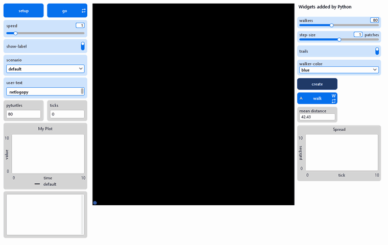

# Interface widgets

## Reading and setting the model's widgets

Sliders, switches, choosers and input boxes are globals of the model:

```python
nl.globals["speed"] = 3
nl.globals["show-label"] = True
nl.globals["scenario"] = "custom"
nl.globals["user-text"] = "hello"
nl.report("count turtles")          # what a monitor would show
```

## Adding widgets from Python

{ .demo }

In the NetLogo window, Python can add every item of NetLogo's *Add* menu:

```python
with NetLogo(gui=True, setup=True) as nl:
    nl.add_slider("walkers", 1, 200, 50, 1)
    nl.add_switch("trails", True)
    nl.add_chooser("walker-color", ["red", "blue"], 0)
    nl.add_input("label-text", "hello")
    nl.add_button("walk", "rt random 50 - 25 fd 1", agents="turtles", forever=True)
    nl.add_monitor("count turtles", "walkers")
    nl.add_plot("Spread", {"distance": "plot mean [distancexy 0 0] of turtles"})
    nl.add_output()                     # if the model has no output area yet
    nl.add_note("Added by Python")
    nl.globals["walkers"] = 80          # set it like any widget
    nl.press_button("walk")             # click it (again to stop a forever button)
```

| Method | NetLogo widget | Notes |
|---|---|---|
| `add_button(label, commands, forever, agents, key)` | Button | `agents`: "observer", "turtles", "patches", "links" |
| `add_slider(name, minimum, maximum, value, step, units, vertical)` | Slider | bounds and step may be NetLogo reporters |
| `add_switch(name, on)` | Switch | |
| `add_chooser(name, choices, selected)` | Chooser | `selected` is an index |
| `add_input(name, value, kind, multiline)` | Input | `kind`: "number", "string", "color", "reporter", "commands" |
| `add_monitor(reporter, label, decimals)` | Monitor | |
| `add_plot(name, pens, x_label, y_label, x_range, y_range, legend, colors, mode)` | Plot | `pens`: names, or `{name: update code}` |
| `add_output(font_size)` | Output | one per model |
| `add_note(text, font_size, color)` | Note | |
| `press_button(label)` | | waits for a normal button; starts or stops a forever button |

- Widgets go in a column to the right of the model's own widgets, unless `x=`
  and `y=` are given (`width=` and `height=` too).
- The model keeps its agents and ticks when a widget is added.
- A name that is already a global, a breed, a procedure or a primitive, or a
  second output area, raises an error; so does a button or a monitor whose
  code does not compile. Nothing is added then.
- A slider starts at 50, or at its minimum when 50 is outside its bounds.
- The widgets last for the session: File > Save As in NetLogo keeps them in a
  model.
- They need the window: in a headless session, `add_...` raises `NetLogoError`.
