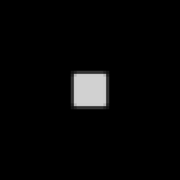
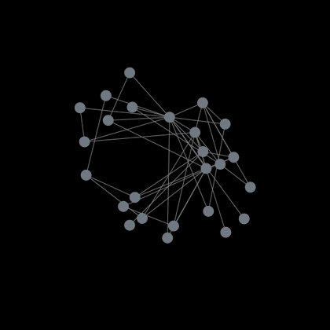

# World, plots and files

## World

```python
nl.resize_world(-50, 50, -50, 50)
nl.set_topology(wrap_x=True, wrap_y=False)
nl.world_width, nl.max_pxcor, nl.patch_size
nl.clear_all(), nl.clear_turtles(), nl.clear_drawing()
```

## Patches in bulk

{ .demo width="320" }

```python
grid = nl.patch_grid("pcolor")                 # rows, top row first
array = nl.patch_grid("elevation", as_array=True)
nl.set_patch_grid("pcolor", grid)              # lists or numpy arrays
nl.diffuse("chemical", 0.5)
nl.import_pcolors("map.png")
nl.import_drawing("background.png")
```

## Plots and output

```python
nl.plot(3.2, plot="My Plot", pen="default")
nl.plotxy(1, 2); nl.histogram([1, 2, 2, 3]); nl.clear_all_plots()
nl.create_temporary_plot_pen("python"); nl.set_plot_pen_color(15)
nl.output_print("hello"); nl.show("in the command center")
```

## Files

```python
nl.export_view("view.png")
nl.export_interface("interface.png")           # window only
state = nl.export_world("state.csv"); nl.import_world(state)
nl.export_plot("My Plot", "plot.csv")
nl.export_all_plots("plots.csv")
```

NetLogo's own file primitives are available too:

```python
nl.file_open("data.txt"); nl.file_write(42); nl.file_print("a line"); nl.file_close()
nl.file_open("data.txt"); nl.file_read(); nl.file_read_line(); nl.file_at_end
```

## Network layouts

{ .demo width="360" }

```python
nl.layout_circle("turtles", 20)
nl.layout_spring("turtles", "links", spring_constant=0.2, spring_length=6,
                 repulsion_constant=2, iterations=50)
nl.layout_radial("turtles", "links", root)
nl.layout_tutte(fixed, "links", 15)
```

## Colors


`netlogopy.colors` has the named colors (`colors.RED == 15`...), `rgb()` and
`rgba()` lists and `shade(color, amount)`; `nl.scale_color()`,
`nl.extract_rgb()` and `nl.approximate_rgb()` use NetLogo's own conversions.
