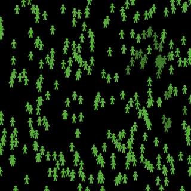
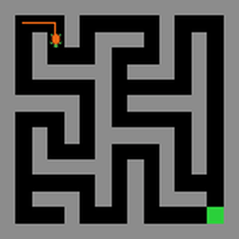
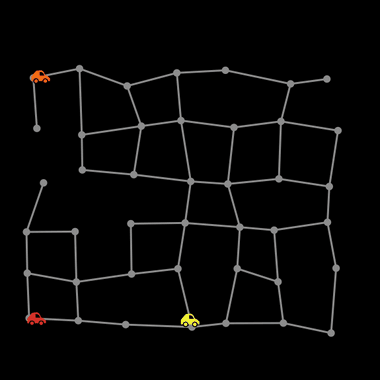

---
hide:
  - navigation
---

# netlogopy { .home-title }

{ .home-banner }

**Run [NetLogo](https://ccl.northwestern.edu/netlogo/) models from Python, and
let Python decide, optimise, learn and measure inside the simulation.**
NetLogo runs inside the Python process, in its own window or headless, and
every NetLogo value, agent and widget is reachable from Python: create and
move agents, read any value as a Python value, run experiments in parallel
and collect data.

<div class="demo-grid demo-grid-3" markdown>
<figure markdown>

<figcaption>An epidemic: a Python policy decides who is vaccinated (<a href="examples/#python-policy">example 38</a>)</figcaption>
</figure>
<figure markdown>

<figcaption>Reinforcement learning: NetLogo is the maze, Python the learner (<a href="examples/#q-learning">example 40</a>)</figcaption>
</figure>
<figure markdown>

<figcaption>Routing: Dijkstra in Python on a NetLogo road network (<a href="examples/#routes">example 41</a>)</figcaption>
</figure>
</div>

```python
from netlogopy import NetLogo

with NetLogo("Wolf Sheep Predation.nlogo") as nl:      # headless by default
    nl.globals["initial-number-wolves"] = 40
    nl.setup()
    data = nl.collect({"sheep": "count sheep", "wolves": "count wolves"}, steps=200)
```

[Install netlogopy](installation.md){ .md-button .md-button--primary }
[Quick start](quickstart.md){ .md-button }
[Examples](examples.md){ .md-button }

## What it does

<div class="grid cards" markdown>

-   :material-code-braces: **The whole NetLogo language**

    `command()` and `report()` run any NetLogo code; results come back as
    Python numbers, strings, booleans, lists and agents.

-   :material-turtle: **Agents as Python objects**

    `Turtle`, `Patch` and `Link` with properties (`turtle.color = 15`) and
    methods (`forward`, `face`, `in_radius`, `hatch`, `create_link_with`...).

-   :material-monitor-eye: **Window or headless**

    Watch the simulation in the NetLogo window, or run any number of headless
    models in parallel threads.

-   :material-play-pause: **Simulation management**

    Step the model from Python, or start it in the background and pause,
    resume and stop it while Python reads and changes it.

-   :material-tune-variant: **Interface widgets**

    Read and set sliders, switches, choosers and inputs, and add new buttons,
    sliders, monitors and plots from Python.

-   :material-chart-line: **Experiments and data**

    Parameter sweeps with repetitions, seeds and parallel workers (like
    BehaviorSpace); time series as dicts or pandas DataFrames.

-   :material-grid: **Bulk patch data**

    Read and write a patch variable for the whole world in one call, as
    lists or numpy arrays.

-   :material-alert-circle-outline: **Errors as exceptions**

    `NetLogoCompileError` and `NetLogoRuntimeError`, with the NetLogo code
    that failed.

</div>

NetLogo 6 and 7 are supported (tested with 6.2.2, 6.3.0 and 7.0.0). NetLogo
runs inside the Python process through [JPype](https://jpype.readthedocs.io):
no Java server, no socket. Scripts written for netlogopy 0.x, and the code of
the [SW25 paper](paper.md), keep working.
